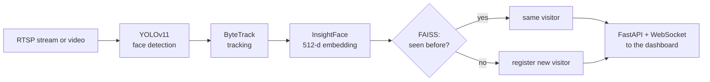

I'm Sanjey. I do the backstage work of AI products: the unexciting but necessary pipeline between a camera feed (or a pile of PDFs) and an answer someone can actually use.

Right now that backstage is **Katomaran**, where I'm spending my internship semester as an AI & Video Analytics intern. I build real-time alerts for intrusion, crowds and perimeter crossing, and a distributed pipeline that fans video out to YOLO inference workers. Back at college, I'm doing a 5-year integrated M.Sc. in Software Systems at **PSG Tech**, Coimbatore (class of '28).

I usually start with the architecture on paper, then build fast with AI coding tools. A lot of what's below started at hackathons.

 

## Things I've built

### [FaceTracker](https://github.com/Sanjey2005/FaceTracker)
*A CCTV setup that knows who walked in, not just that someone did.*

This was my entry for Katomaran's hackathon, a couple of months before I joined them. It takes up to four RTSP streams, finds faces with YOLOv11, follows them with ByteTrack, and matches them against a FAISS index of InsightFace embeddings, so every visitor is counted once. Entry and exit events show up on a React dashboard over WebSockets.

`YOLOv11` `ByteTrack` `InsightFace` `FAISS` `FastAPI` `React`

<b>How a frame becomes a visitor count</b>

 

### [Placement Chronicles](https://github.com/Sanjey2005/placement-chronicles) · [live](https://placement-chronicles.vercel.app)
*Every senior's interview story, searchable.*

Our seniors' interview experiences were sitting in 100+ PDFs. I turned them into something you can just ask, like *"what did Caterpillar ask in round 2?"*, and get an answer pulled from the real write-ups. 400+ PSG Tech students have used it to prep.

`Next.js` `MongoDB Atlas Vector Search` `Gemini` `RAG`

### [PlanB](https://github.com/Sanjey2005/PlanB)
*For the days that don't go to plan.*

A scheduling assistant that lives in WhatsApp. When a meeting gets cancelled, traffic jams or an urgent email lands, it works out what that breaks, reshuffles your Google Calendar, drafts the "can we move this?" emails and texts you a summary. No app to open. It's 14 LangGraph agents on AWS Lambda, built at Neoverse '26.

`LangGraph` `Llama 3.3 70B` `Gemini` `FastAPI` `AWS Lambda` `WhatsApp API`

### [Distributed SandPy](https://github.com/Sanjey2005/Distributed_SandPy)
*Stateful Python execution that scales past one box.*

We took an [open-source single-machine sandbox](https://github.com/anukriti-ranjan/sandboxed-jupyter-code-exec) (one Jupyter kernel per session) and made it distributed. A FastAPI dispatcher queues jobs in Redis, claims the least-busy worker with an atomic Lua script, keeps each user on the same worker, elects one leader among several dispatchers, and streams job status back over WebSockets.

`FastAPI` `Redis` `Docker` `Jupyter` `WebSockets`

### [QuizCraft AI](https://github.com/Sanjey2005/QuizCraftAI)
*Notes in, quiz out.*

Drop in a PDF or DOCX and get a curriculum-aligned quiz back in about 30 seconds. Llama 3.1 70B writes the questions, and Celery and Redis do the waiting so the web app doesn't have to. Classrooms, timed attempts and leaderboards sit on top. Built at the TeachEdison Hackathon 2026.

`Django REST` `Celery` `Redis` `PostgreSQL` `Next.js` `Llama 3.1 70B`

**Also:** [sentiment analysis on 1.6M tweets](https://github.com/Sanjey2005/TwitterSentimentAnalysis), comparing logistic regression, random forests, LSTM and BERT, with fairness and adversarial-robustness checks.

 

## Right now

- Working through NeetCode 150, one problem a day, in Python.
- Looking for full-time backend, ML or computer vision roles from 2028.
- What's usually open on my screen: Python, FastAPI, PyTorch, OpenCV, YOLO, vLLM, PostgreSQL, Redis, RabbitMQ, Docker.

## Say hi

If you're hiring, or you just want to talk about video pipelines, I'm on [LinkedIn](https://www.linkedin.com/in/shree-sanjey-404547285/) and at [sanjey8105@gmail.com](mailto:sanjey8105@gmail.com).
